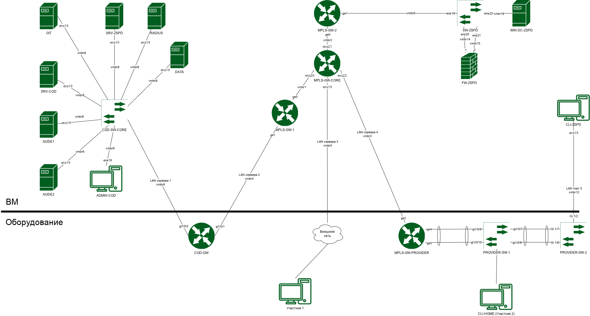
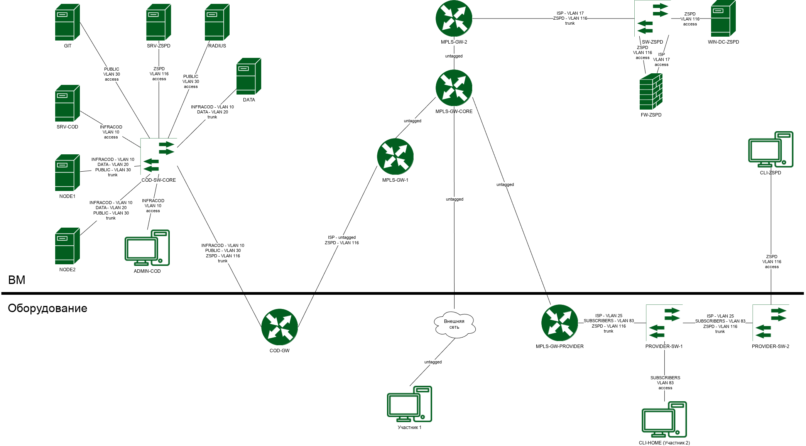
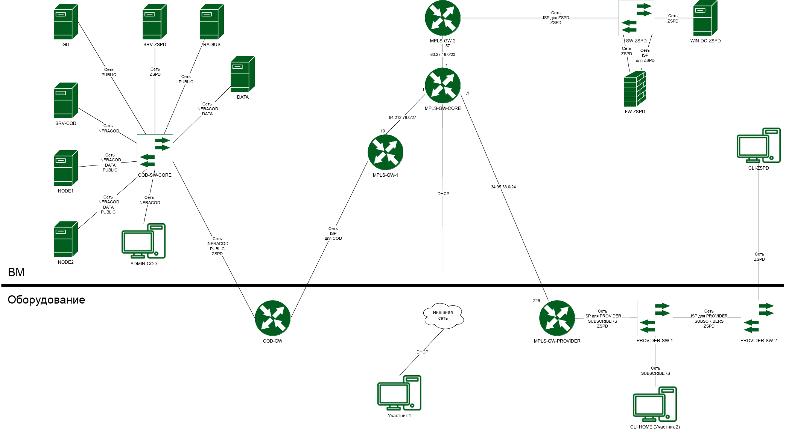

# Пусконаладка сетевой инфраструктуры

## 1. Справочные данные и таблицы ВМ/Оборудование/ОС

| ВМ/Оборудование | ОС |
| :---              | :---         |
| MPLS-GW-CORE (ВМ) | Альт JeOS 11 |
| MPLS-GW-1 (ВМ) | EcoRouterOS-Pesto |
| MPLS-GW-2 (ВМ) | EcoRouterOS-Pesto |
| MPLS-GW-PROVIDER (Оборудование) | EcoRouterOS-Edelweiss |
| COD-GW (Оборудование) | Eltex ESR-10 |
| COD-SW-CORE | Виртуальный коммутатор (в гипервизоре) |
| PROVIDER-SW-1 (Оборудование) | Eltex MES2308P |
| PROVIDER-SW-2 (Оборудование) | CIT SB210-10T Switch |
| SW-ZSPD (ВМ) | Альт JeOS 11 |
| FW-ZSPD (ВМ) | Ideco NGFW Novum 22 |
| NODE1 (ВМ) | Альт Виртуализация 11.1 Редакция PVE |
| NODE2 (ВМ) | Альт Виртуализация 11.1 Редакция PVE |
| DATA (ВМ) | Альт Сервер 11.1 |
| ADMIN-COD (ВМ) | Альт Рабочая станция 11.2 |
| SRV-COD (ВМ) | Альт Сервер 11.1 |
| WIN-DC-ZSPD (ВМ) | Windows Server 2022 |
| RADIUS | Альт JeOS 11 |
| GIT | Альт Сервер 11.1 |
| CLI-HOME (Рабочее место участника 2) | ОС рабочего места участника 2 |
| CLI-ZSPD | Альт Рабочая станция 11.2 |
| SRV-ZSPD | Альт Сервер 11.1 |

---

## 2. Настройка базовых параметров

### Имена устройств и Доменные зоны
* Настройте имена устройств в соответствии с топологией.
* **Домен `ssa.prof`:** использовать на устройствах `COD-GW`, `MPLS-*`, `PROVIDER-SW-*`, `FW-ZSPD` и `SW-ZSPD`.
* **Домен `cod.ssa.prof`:** использовать на устройствах `*-COD`.
* **Домен `zspd.ssa.prof`:** использовать на устройствах `*-ZSPD`.
* На остальных устройствах использовать доменное имя не требуется.

### Учетные записи и Безопасность
* На устройствах `COD-GW`, `MPLS-GW-*`, `PROVIDER-SW-*`, `SW-ZSPD` добавьте административную учетную запись **master** с паролем `P@ssw0rd`.
* **MPLS-GW-CORE:** обеспечить выполнение утилиты `sudo` без запроса пароля.
* **Маршрутизаторы MPLS-GW-*:**
  * Сконфигурируйте хранение паролей в защищенном виде.
  * Деактивируйте встроенную учетную запись администратора.
* **COD-GW и PROVIDER-SW-*:** настройте пароль для режима `enable`. Пароль: `P@ssw0rd`.
* **FW-ZSPD:** интегрируйте администратора из RADIUS.

### Административный доступ (SSH)
* Обеспечьте доступ по протоколу SSH с использованием доменных имен согласно Таблице 4.
* Требуется возможность подключения к сетевым устройствам с хоста `ADMIN-COD` через приложение **PuTTY**.
* Для подключения к `FW-ZSPD` используйте пользователя на RADIUS-сервере.

### IP-адресация и Интернет
* Настройте адресацию в соответствии с топологией. Если IP-адреса для сети не указаны — настройте их на ваше усмотрение.
* **Важно:** при самостоятельной настройке обязательно обеспечьте доступ к устройствам и сервисам по DNS. *Заказчик не занимается аудитом: если сервис недоступен по доменному имени, проверка производиться не будет!*
* **MPLS-GW-CORE:** для доступа в Интернет должен получать IP-адрес по DHCP.

---

## 3. Настройка маршрутизации и MPLS-сети

### Протокол BGP (Провайдерская сеть)
* Настройте обмен маршрутной информацией между маршрутизаторами `MPLS-GW-*`.
* **ASN:** `64499` (AS Провайдера).
* Доступ в Интернет предоставляется через `MPLS-GW-CORE`. Передача маршрутов — по **iBGP**.
* Используйте интерфейсы **dummy/loopback** для установления соседства по iBGP.
* **В качестве IGP используйте IS-IS:**
  * Маршрутизация в пределах одной зоны.
  * Выбранные адреса dummy/loopback используются в качестве *SYSTEM ID*.
  * *RID BGP* должен соответствовать адресу dummy/loopback интерфейса устройства.
* При передаче маршрутов в другие автономные системы используйте фильтрацию. Передавать все маршруты запрещено.

### Технология MPLS и VPLS
* Выполните настройку VPLS-сервиса в режиме **Martini mode**.
* **Роли устройств:**
  * Пограничные маршрутизаторы (PE): `MPLS-GW-*`.
  * Опорный маршрутизатор (P): `MPLS-GW-CORE`.
* Порты для подключения клиентских маршрутизаторов (CE) назначьте согласно топологии.

### Сервис Pseudowire
* Реализуйте Pseudowire до VPLS-сети.
* Терминирующее устройство (MTU-r): `COD-GW`.
* Маршруты, необходимые для организации Pseudowire, передайте провайдеру по протоколу **OSPF**.
* Внутри сети ЗСПД используйте адресацию `10.0.0.0/16`.
* Трафик ЗСПД по MPLS-сети передавайте **без меток 802.1ad**.

---

## 4. Настройка коммутации (L2)

### COD-SW-CORE
* Является программным коммутатором на уровне гипервизора.
* Настройте VID (тег) на портах (Network Device в Hardware ВМ) оконечных устройств (виртуальных машин).

### SW-ZSPD
* Является программным коммутатором на базе **Open vSwitch**.
* Имя коммутатора должно совпадать с коротким именем устройства (использовать заглавные буквы: `SW-ZSPD`).
* Разрешите на магистральных каналах только используемые VLAN.
* `WIN-DC-ZSPD` должен получать **нетегированный** трафик.
* Создайте интерфейс управления с именем **MGMT** (используйте сеть *ISP* из Таблицы 3).

### PROVIDER-SW-*
* Являются аппаратными коммутаторами.
* Разрешите на магистральных каналах только используемые VLAN.
* `CLI-HOME` и `CLI-ZSPD` должны получать **нетегированный** трафик.
* Для управления коммутатором создайте интерфейс с адресацией из сети *ISP* (Таблица 2).
* Агрегируйте каналы согласно топологии с использованием протокола **LACP**.

---

## 5. Оптимальная адресация (PA-диапазон)

Настройте адресацию из подсети `78.23.0.0/24` с учётом максимального количества полезных IPv4-адресов:
* **COD-GW** – 6 адресов;
* **FW-ZSPD** – 30 адресов;
* **MPLS-GW-PROVIDER** – 62 адреса.

---

## 6. Настройка сети ЦОД (COD)

* Сегментируйте сетевое пространство в соответствии с Таблицей 1 и топологией.
* Трафик `DATA` и `ZSPD` **не должен** маршрутизироваться.
* **BGP/OSPF параметры:**
  * **ASN:** `65005` (AS ЦОД-А).
  * **IGP:** OSPF. Интерфейсы, не участвующие в OSPF, переведите в пассивный режим (`passive-interface`).
  * `COD-GW` по OSPF должен получать **только** маршрут до loopback-адреса на `MPLS-GW-1`.
  * На `MPLS-GW-1` настройте перераспределение (redistribution) OSPF маршрутов в BGP.
  * Используйте loopback-интерфейсы для установления соседства по BGP.
  * *RID OSPF и BGP* должен соответствовать адресу loopback-интерфейса устройства.
* Обеспечьте передачу маршрутной информации для взаимодействия COD с внешними сетями.
* `COD-GW` должен получать маршрут по умолчанию по BGP.
* Анонсируйте Провайдеру по BGP подсеть `212.78.93.0/24` для публикации ресурсов. Передача внутренних подсетей Провайдеру запрещена.

---

## 7. Трансляция адресов (NAT) и BRAS

### Настройка NAT
* **MPLS-GW-CORE:** обеспечьте трансляцию PA-диапазона `78.23.0.0/16` и PI-диапазона `212.78.93.0/24` для доступа в Интернет.
* Использование NAT допускается **только** на `COD-GW`, `MPLS-GW-PROVIDER`, `MPLS-GW-CORE`.
* **MPLS-GW-PROVIDER:** используйте пул из любых 3-х PA-адресов из диапазона провайдера для NAT абонентов.

### Настройка BRAS (на MPLS-GW-PROVIDER)
* `CLI-HOME` подключается к Интернету по протоколу **IPoE**.
* Создайте список `CLI-HOME` с группой разрешенных IP-адресов.
* Создайте сервисы и политики абонентов:
  * `SERVICE-INTERNET` с политикой `POLICY-INTERNET` (разрешает доступ).
  * `SERVICE-INTERNET-NO` с политикой `POLICY-INTERNET-NO` (запрещает доступ).
* Создайте карту абонента `MAP-CLI-HOME`:
  * Динамическое правило проверяет трафик на соответствие списку `CLI-HOME`.
  * Назначает сервисы `SERVICE-INTERNET` и `SERVICE-INTERNET-NO` для подходящих абонентов.
  * При локальной аутентификации пользователям должен назначаться сервис `SERVICE-INTERNET-NO`.
* Для внутренних IP-адресов используйте подсеть `10.10.0.0/16`.
* **DHCP-сервер (на MPLS-GW-PROVIDER):** время аренды параметров — 5 минут.
* Используйте **RADIUS** для аутентификации (атрибут — неформатированный MAC).

---

## 8. Инфраструктурные сервисы (RADIUS, DNS, DHCP, NTP)

### Настройка RADIUS-сервера
* Создайте клиентов `MPLS-GW-PROVIDER` и `FW-ZSPD` с паролем `P@ssw0rd`.
* **Запрещено** использовать клиента с адресом `0.0.0.0/0`.
* Настройте необходимые словари для EcoRouter и Ideco.
* **Пользователи:**
  * Создайте пользователя на основе MAC-адреса `CLI-HOME` (привяжите сервис `SERVICE-INTERNET`).
  * Пользователь `cli-zspd` (пароль `P@ssw0rd1234`) для подключения к `FW-ZSPD` через Ideco Client.
  * Пользователь `master` (пароль `P@ssw0rd`) для подключения к `FW-ZSPD` по SSH.

### Служба доменных имен (DNS)
* **MPLS-GW-CORE (Основной DNS):**
  * Доступен только по адресам `127.0.0.1` и dummy/loopback.
  * Обслуживает зону `ssa.prof` (согласно Таблице 4).
  * DNS пересылки (forwarder): `100.100.100.100`.
  * Все устройства с выходом в Интернет используют его как основной DNS.
* **FW-ZSPD (DNS для ЗСПД):**
  * Внешний DNS-сервер: `MPLS-GW-CORE`.
  * Включите перехват пользовательских DNS-запросов.
  * `CLI-ZSPD` и `SRV-ZSPD` используют этот сервер как основной.
* **SRV-COD (DNS для ЦОД):**
  * Обслуживает зону `cod.ssa.prof` (согласно Таблице 5).
  * Внешний DNS-сервер: `MPLS-GW-CORE`.

### Протокол DHCP (на SRV-COD)
* Реализуйте DHCP-сервер на базе **Kea-DHCPv4** для обслуживания подсети `INFRACOD`.
* Диапазон адресов: со `100` по `200` включительно.
* Шлюз: адрес маршрутизатора в этой сети. DNS-сервер: `SRV-COD`. DNS-суффикс: `cod.ssa.prof`.
* `ADMIN-COD` должен получать параметры автоматически.
* Настройте динамическое обновление DNS (записи типа A и PTR должны обновляться при выдаче IP).

### Синхронизация времени (NTP)
* Сервер времени: `MPLS-GW-CORE` (**Stratum 5**). Внешний источник для него: `127.0.0.1`. Часовой пояс: Московский.
* Устройства `SW-ZSPD`, `FW-ZSPD` и `MPLS-GW-PROVIDER` синхронизируются с `MPLS-GW-CORE`. Используйте **chrony**, где это возможно. Часовой пояс: Московский.

---

## 9. Безопасность и Доступ в сеть ЗСПД (FW-ZSPD)

* Настройте интеграцию с RADIUS.
* **Аутентификация:** каталог по умолчанию — RADIUS, доменный суффикс локальных пользователей — `.local`.
* **SRV-ZSPD:** настройте постоянную авторизацию по IP и MAC (локальный пользователь `srv-zspd` / `P@ssw0rd1234`).
* **CLI-ZSPD:** авторизация через Ideco Client.
  * Профиль `CLI-ZSPD` (RADIUS-пользователь `cli-zspd` / `P@ssw0rd1234`).
  * Профиль `CLI-ZSPD-LOCAL` (локальный пользователь `cli-zspd-local` / `P@ssw0rd1234`).

---

## 10. Кластер виртуализации и Хранение данных

### Кластер виртуализации
* Ноды кластера: `NODE1`, `NODE2`. Имя кластера: `cluster`.
* Сеть кластера: `INFRACOD`. Устройство Q-Device: `SRV-COD`.
* На каждой ноде создайте сетевой мост **vmbr1** связанный с сетью `PUBLIC` (без назначения IP мосту).
* **iSCSI Хранилище:** ID цели — `iscsi`, сеть — `DATA`. Прямой доступ к LUN не использовать.
* **LVM Хранилище:** ID — `data`, на базе общего хранилища `iscsi`, имя группы томов — `data`. Предоставьте общий доступ для дисков и контейнеров.
* **Веб-интерфейс нод:** при доступе с `ADMIN-COD` не должно быть ошибок сертификатов. Используйте сертификаты ЦС. Доступ должен быть как по DNS, так и по IP.

### Устройство хранения данных (DATA)
* Хост: `DATA`. Управление через сеть `INFRACOD`, взаимодействие с кластером через сеть `DATA`.
* Диски сгруппировать в **RAID 0**.
* Протокол iSCSI, имя цели: `iqn.2026-11.prof.ssa.cod:data`.

### Центр сертификации (CA)
* Разверните CA на `SRV-COD`. Директория файлов: `/etc/ca`.
* Срок корневого сертификата: 5 лет.
* Параметры: C=RU, O=PROF, OU=SSA, CN=COD.
* `ADMIN-COD` и `CLI-*` должны доверять этому ЦС. Используйте его для выпуска всех требуемых сертификатов.

---

## 11. Базы данных и Мониторинг

### Сервер баз данных (PostgreSQL)
* Хост: `SRV-COD`. Версия СУБД: **PostgreSQL 18**. Пароль пользователя `postgres`: `P@ssw0rd`.
* Создайте суперпользователя `superadmin` с паролем `P@ssw0rdSQL` (полный доступ).
* **Управление (pgAdmin4):**
  * Установите на `SRV-COD` в режиме веб-сервера.
  * Веб-интерфейс: `https://srv-cod.cod.ssa.prof:5050`. Настройте редирект с HTTP (порт 5050) на HTTPS без ошибок.
  * Логин: `pgadmin@cod.ssa.prof`, пароль: `P@ssw0rd`. Registered server: подключите базу через `superadmin`.

### Система мониторинга (Zabbix)
* Сервер: `SRV-COD`. Версия: **Zabbix >= 7.0**. Веб-сервер: **NGINX**.
* БД: PostgreSQL на `SRV-COD` (Имя: `zabbix`, пользователь: `zabbix_user`, пароль: `P@ssw0rdZabbix`).
* Веб-интерфейс: `https://srv-cod.cod.ssa.prof:8080`. Настройте редирект с HTTP на HTTPS без ошибок.
* Администратор: `Admin` / `P@ssw0rd`. Часовой пояс: `Europe/Moscow`.
* **Узлы сети (Мониторинг):**
  * `COD-GW` (группа *Network devices*, шаблон *Cisco IOS by SNMP*).
  * `NODE*` (группа *Hypervisors*, шаблоны *Proxmox VE by HTTP* и *Linux by Zabbix agent*).
  * Имена узлов должны быть заглавными буквами. Интерфейсы узлов настраивать по DNS-имени.

---

## 12. Виртуальные машины в ЦОД

* Создайте ВМ на базе **Alt Linux Cloud**: `SRV1` (ID 100) на `node1`, `SRV2` (ID 101) на `node2`.
* Характеристики: CPU 1 socket / 2 cores, RAM 2 GB, без CD-привода. Диски разместить в общем хранилище (образ `alt-server-11.1-p11-cloud-x86_64.qcow2` из `addons.iso`).
* **Cloud-Init:**
  * Диск Cloud-Init в общем хранилище.
  * Пользователь `vmuser` c паролем `P@ssw0rd`.
  * Сетевые настройки и DNS согласно Таблице 4 и топологии.
  * Настройте открытый ключ SSH для доступа с `ADMIN-COD` под пользователем `user`.
* Реализуйте возможность запуска консоли `xterm.js`.

---

## 13. Платформа GitFlic и CI/CD пайплайны

### Установка GitFlic
* Хост `GRID`/`GIT`, режим *Self-Hosted* (архив из `addons.iso`).
* БД: PostgreSQL на `SRV-COD` (Имя: `gitflic`, пользователь: `gitflic_user`, пароль: `P@ssw0rdGitFlic`).
* URL: `git.ssa.prof` (редирект с HTTP на HTTPS без ошибок).
* Пароль `adminuser@admin.local` изменить на `P@ssw0rd`.
* Зарегистрируйте пользователя **Devops Master** (`devops@ssa.prof` / `P@ssw0rd`) и создайте приватный проект `app`.

### GitFlic Runner
* Установите на `SRV1` и `SRV2` в режиме **Shell** (не в контейнере).
* Регистрация в проекте `app`:
  * На `SRV1` — имя `SRV1`, тег `prod`.
  * На `SRV2` — имя `SRV2`, тег `test`.

### Работа с кодом и пайплайнами (CI/CD)
Разместите код `app.zip` и добавьте `Dockerfile` (база `python_3.8-flask.tar`). Пайплайн состоит из 4 этапов:
1. **build:** сборка образа `app:$CI_PIPELINE_IID`. Запуск на раннере `test` в ручном режиме.
2. **test:** запуск контейнера `app-$CI_PIPELINE_IID`. Авто-удаление старых контейнеров приложения. Тестовая БД — PostgreSQL (`postgres_latest.tar`). Запуск на раннере `test` автоматически. Доступность: `http://app-test.ssa.prof`.
3. **push:** отправка образа в Реестр с тегом `latest`. Удаление неиспользуемых образов. Запуск на раннере `test` вручную.
4. **prod:** запуск контейнера `app-prod` из образа `latest`. Удаление старых версий. БД на `SRV-COD` (Имя: `appdb`, пользователь: `appuser`, пароль: `AppPassword`). Запуск на раннере `prod` вручную. Доступность: `http://app.ssa.prof`.

---

## 14. Перевод инфраструктуры на Альт Домен (Миграция)

* Установите контроллер домена на базе **Samba-DC** на хост `SRV-ZSPD`.
* Настройте роли: PDC Samba-DC, LDAP, SYSVOL, роль DNS (Таблица 6). Функциональный уровень AD — не ниже **Windows Server 2016**.
* **Групповая политика:** создайте GPO `ZSPDStyle`, устанавливающую темную тему по умолчанию и запрещающую пользователям её менять.
* Настройте анонимную общую папку `Share`.
* **Правила миграции с WIN-DC-ZSPD на SRV-ZSPD:**
  * Сохранить параметры и свойства всех объектов.
  * Идентификаторы клиентов (`SUID`) и элементов (`GUID`) не должны измениться.
  * Все существующие `GPO` перенести с сохранением их оригинальных `GUID`.
* После миграции хост `WIN-DC-ZSPD` должен быть выключен, а информация о нем удалена из домена.

---

## 15. Сводные конфигурационные таблицы (VLAN и DNS)

### Таблица 1 — VLAN в COD

| Описание сети | Служебное имя | VLAN |
| :--- | :--- | :--- |
| Магистральный трафик провайдера | ISP | untagged |
| Трафик ЗСПД | ZSPD | 116 |
| Трафик инфраструктуры | INFRACOD | 10 |
| Внутренний трафик СХД | DATA | 20 |
| Анонсируемые другим AS адреса | PUBLIC | 30 |

### Таблица 2 — VLAN в PROVIDER

| Описание сети | Служебное имя | VLAN |
| :--- | :--- | :--- |
| Магистральный трафик провайдера | ISP | 25 |
| Трафик ЗСПД | ZSPD | 116 |
| Трафик клиентов BRAS | SUBSCRIBERS | 83 |

### Таблица 3 — VLAN в ZSPD

| Описание сети | Служебное имя | VLAN |
| :--- | :--- | :--- |
| Магистральный трафик провайдера | ISP | 17 |
| Трафик ЗСПД | ZSPD | 116 |

### Таблица 4 — Описание доменной зоны ssa.prof

| Устройство | Полное доменное имя | Тип записи | Адрес, который был назначен на интерфейс |
| :--- | :--- | :--- | :--- |
| MPLS-GW-CORE | mpls-gw-core.ssa.prof | A | dummy/loopback |
| MPLS-GW-1 | mpls-gw-1.ssa.prof | A | loopback |
| MPLS-GW-2 | mpls-gw-2.ssa.prof | A | loopback |
| MPLS-GW-PROVIDER | mpls-gw-provider.ssa.prof | A | loopback из сети ISP PROVIDER |
| COD-GW | cod-gw.ssa.prof | A | loopback |
| PROVIDER-SW-1 | provider-sw-1.ssa.prof | A | из сети ISP PROVIDER |
| PROVIDER-SW-2 | provider-sw-2.ssa.prof | A | из сети ISP PROVIDER |
| FW-ZSPD | fw-zspd.ssa.prof | A | из сети ISP ZSPD |
| SW-ZSPD | sw-zspd.ssa.prof | A | MGMT |
| SRV1 | srv1.ssa.prof | A | из сети PUBLIC |
| *прокси-запись* | app.ssa.prof | CNAME | srv1.ssa.prof |
| SRV2 | srv2.ssa.prof | A | из сети PUBLIC |
| *прокси-запись* | app-test.ssa.prof | CNAME | srv2.ssa.prof |
| GIT | git.ssa.prof | A | из сети PUBLIC |
| RADIUS | radius.ssa.prof | A | из сети PUBLIC |

### Таблица 5 — Описание доменной зоны cod.ssa.prof

| Устройство | Полное доменное имя | Тип записи | Адрес, который был назначен на интерфейс |
| :--- | :--- | :--- | :--- |
| SRV-COD | srv-cod.cod.ssa.prof | A, PTR | из сети INFRACOD |
| NODE1 | node1.cod.ssa.prof | A, PTR | из сети INFRACOD |
| NODE2 | node2.cod.ssa.prof | A, PTR | из сети INFRACOD |
| DATA | data.cod.ssa.prof | A, PTR | из сети INFRACOD |
| ADMIN-COD | admin-cod.cod.ssa.prof | A, PTR | DHCP |

### Таблица 6 — Описание доменной зоны zspd.ssa.prof

| Устройство | Полное доменное имя | Тип записи | Адрес, который был назначен на интерфейс |
| :--- | :--- | :--- | :--- |
| WIN-DC-ZSPD | win-dc-zspd.zspd.ssa.prof | A, PTR | из сети ZSPD |
| SRV-ZSPD | srv-zspd.zspd.ssa.prof | A, PTR | из сети ZSPD |
| CLI-ZSPD | cli-zspd.zspd.ssa.prof | A, PTR | из сети ZSPD |
